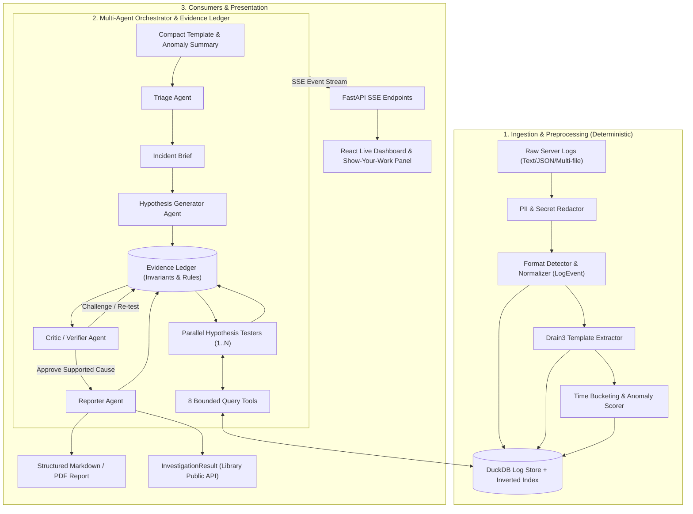
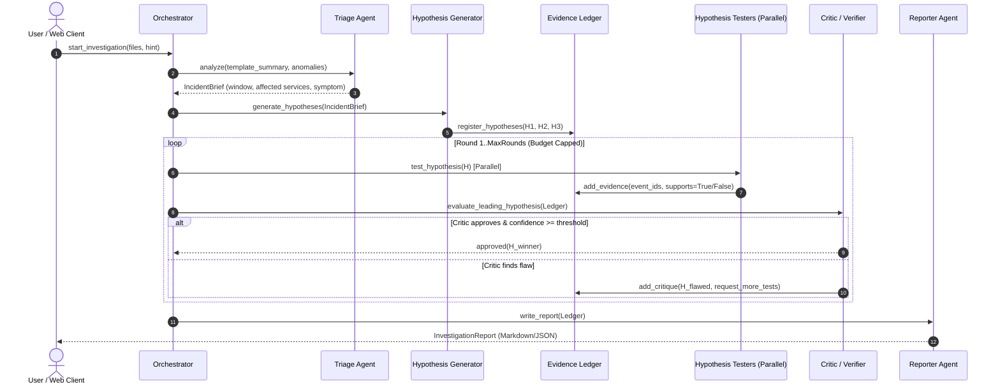

# Implementation Plan: Log and Incident Investigator System

An enterprise-grade, agentic root-cause investigation engine that ingests high-volume server logs, condenses them using deterministic template extraction and time bucketing, dispatches a coordinated multi-agent team to hypothesize and test causes using structured tools over DuckDB, enforces strict evidence ledger citations, and generates verified incident reports. Built library-first (`incident_investigator`) with a companion real-time streaming web dashboard (`web/`).

---

## 1. Goal Description

When production incidents occur, engineers are faced with gigabytes of messy, multi-service logs across distributed systems. Feeding raw logs directly to Large Language Models (LLMs) is impossible due to context window limits, cost, and hallucination risks.

This project delivers:
1. **Core Engine (`incident_investigator`)**: A standalone, zero-web-dependency Python library that deterministically reduces large logs via Drain3 template extraction, indexes them into an in-memory/columnar DuckDB log store, provides 8 bounded query tools, coordinates a 5-role agent system (Triage, Hypothesis Generator, Hypothesis Tester, Critic/Verifier, Reporter), enforces temporal and citation rules in a central **Evidence Ledger**, and generates trustworthy root-cause reports.
2. **Web Application (`web/`)**: A FastAPI backend providing Server-Sent Events (SSE) streaming and a modern React (Vite + Tailwind CSS) dashboard featuring real-time hypothesis cards, a live tool-execution feed, an interactive timeline, and a "Show Your Work" audit panel.
3. **Synthetic Incident Benchmark**: A suite of realistic reproducible failure scenarios (e.g., DB pool exhaustion, cascading timeouts, OOM kills, faulty deploy) with automated evaluation of root-cause accuracy and citation precision.

---

## 2. Architecture & Data Flow



---

## 3. User Review Required

> [!IMPORTANT]
> **LLM Provider Strategy**: The system will feature a clean `LLMProvider` protocol with adapters for OpenAI (`gpt-4o`, `o3-mini`), Anthropic (`claude-3-5-sonnet`), and Gemini (`gemini-2.0-flash`). Additionally, a deterministic `MockLLMProvider` will be implemented so that the entire test suite and synthetic benchmarks run reliably offline without requiring API keys or incurring token costs.
>
> **Python Version Target**: We will configure the project with `uv` targeting Python 3.12 (which is available in your environment and guarantees pre-built wheels for `duckdb`, `pydantic-v2`, and `drain3`).
>
> **Workspace Layout**: We will structure the repository cleanly into:
> - `incident_investigator/`: The core standalone engine and library.
> - `web/`: FastAPI backend and React frontend.
> - `benchmark/`: Synthetic incident generators and evaluation harnesses.
> - `tests/`: Comprehensive unit, ledger-integrity, and end-to-end integration tests.

---

## 4. Open Questions

> [!NOTE]
> None that block Phase 1 kickoff. The design provides modular plug-and-play abstractions for log parsers, LLM providers, and storage backends.

---

## 5. Detailed Component Specifications

### 5.1 Data Models & Schemas (`incident_investigator/models.py`)

```python
from datetime import datetime
from enum import Enum
from typing import List, Optional, Dict, Any
from pydantic import BaseModel, Field

class LogLevel(str, Enum):
    DEBUG = "DEBUG"
    INFO = "INFO"
    WARN = "WARN"
    ERROR = "ERROR"
    FATAL = "FATAL"
    UNKNOWN = "UNKNOWN"

class LogEvent(BaseModel):
    event_id: str = Field(description="Unique event ID (e.g. evt_01h8...)")
    timestamp: datetime
    level: LogLevel
    service: str
    message: str
    template_id: Optional[str] = None
    trace_id: Optional[str] = None
    request_id: Optional[str] = None
    source_file: str
    line_number: int
    attributes: Dict[str, Any] = Field(default_factory=dict)
    raw_line: str

class TemplateCluster(BaseModel):
    template_id: str
    pattern: str  # e.g., "Connection to <PARAM> timed out after <PARAM>ms"
    sample_message: str
    total_count: int
    first_seen: datetime
    last_seen: datetime
    services: List[str]
    is_anomaly: bool = False
    anomaly_score: float = 0.0

class HypothesisStatus(str, Enum):
    OPEN = "open"
    TESTING = "testing"
    SUPPORTED = "supported"
    REFUTED = "refuted"
    INCONCLUSIVE = "inconclusive"

class EvidenceItem(BaseModel):
    evidence_id: str
    hypothesis_id: str
    event_ids: List[str] = Field(description="Strict list of referenced event IDs")
    summary: str
    supports: bool  # True if supports, False if refutes
    tool_call_id: str
    earliest_timestamp: Optional[datetime] = None
    latest_timestamp: Optional[datetime] = None
    explanation: str

class Hypothesis(BaseModel):
    id: str
    statement: str
    predicted_evidence: List[str]
    falsification_conditions: List[str]
    status: HypothesisStatus = HypothesisStatus.OPEN
    confidence: float = 0.0  # 0.0 to 1.0
    evidence: List[EvidenceItem] = Field(default_factory=list)
    tests_run: List[str] = Field(default_factory=list)
    critic_notes: Optional[str] = None

class IncidentBrief(BaseModel):
    incident_window_start: datetime
    incident_window_end: datetime
    affected_services: List[str]
    primary_symptoms: List[str]
    anomalous_templates: List[TemplateCluster]
    user_hint: Optional[str] = None

class InvestigationReport(BaseModel):
    incident_id: str
    executive_summary: str
    root_cause: str
    confidence: float
    incident_timeline: List[Dict[str, Any]]
    supported_hypothesis: Optional[Hypothesis]
    ruled_out_hypotheses: List[Hypothesis]
    verified_evidence_event_ids: List[str]
    recommended_mitigations: List[str]
    unknowns: List[str]
    total_tokens_used: int
    total_tool_calls: int
    investigation_duration_seconds: float
```

---

### 5.2 Deterministic Ingestion & Preprocessing

1. **Redaction Layer (`incident_investigator/preprocess/redactor.py`)**:
   - Regex-based scrubber for emails, IPv4/IPv6, Bearer/JWT tokens, API keys, passwords, credit card patterns.
   - Replaces with tokens: `<REDACTED_IP>`, `<REDACTED_EMAIL>`, `<REDACTED_TOKEN>`.
2. **Format Parsers (`incident_investigator/ingest/`)**:
   - `JsonLogParser`: Handles JSON formatted lines (`ts`/`time`/`timestamp`, `level`/`severity`, `service`/`app`, `msg`/`message`, `trace_id`).
   - `RegexLogParser`: Standard Syslog, Apache/Nginx, Logback/Log4j patterns (`YYYY-MM-DD HH:MM:SS [LEVEL] [SERVICE] ...`).
   - `AutoParser`: Heuristic detector sampling the first 50 lines to select the parser.
3. **Template Extraction (`incident_investigator/preprocess/drain.py`)**:
   - Wraps `drain3` (Template Miner) to collapse unbounded variations into parameterized templates.
4. **Time Bucketing & Anomaly Scoring (`incident_investigator/preprocess/analyzer.py`)**:
   - Slices timeline into 1-minute and 5-minute buckets.
   - Computes template occurrence frequency distributions.
   - Flags anomalies via z-score spike detection ($z = (x - \mu) / \sigma > 3.0$), first-seen detection (template never seen before incident window), and error-rate escalation.

---

### 5.3 DuckDB Log Store & 8 Bounded Investigation Tools (`incident_investigator/store/` and `tools/`)

The DuckDB store maintains structured tables:
- `events` (indexed on `timestamp`, `level`, `service`, `trace_id`, `template_id`)
- `templates`
- `bucket_counts`

The 8 Investigation Tools (strictly read-only, bounded outputs):
1. `search_logs(query: str, time_range: Optional[tuple], service: Optional[str], level: Optional[str], limit: int = 50)` -> returns truncated records with `event_id`.
2. `get_template_stats(template_id: str, time_range: Optional[tuple])` -> returns counts per minute and spike metrics.
3. `get_context(event_id: str, before: int = 5, after: int = 5)` -> returns surrounding events in the same service/file to inspect local causality.
4. `trace_request(request_id: str)` -> reconstructs the cross-service execution path of a single request.
5. `compare_windows(window_a: tuple, window_b: tuple)` -> diffs template frequencies between a healthy baseline and the failure period.
6. `find_first_occurrence(template_id: str)` -> returns the earliest timestamp and `event_id` where a specific error/template occurred.
7. `correlate(template_a: str, template_b: str)` -> evaluates lag correlation: does template A reliably precede template B within $T$ seconds?
8. `get_service_dependencies()` -> analyzes call flows and error cascades across services.

---

### 5.4 Evidence Ledger Invariants (`incident_investigator/ledger/`)

The Ledger is the core safety and trust mechanism:
- **Rule 1 (Strict Citation)**: No hypothesis may transition to `SUPPORTED` without linking to verified `event_ids` stored in DuckDB.
- **Rule 2 (Temporal Precedence Invariant)**: For a hypothesis to be supported, the cause's earliest verified event timestamp must strictly precede the incident symptom's timestamp:
  $$t_{\text{cause}} < t_{\text{symptom}}$$
- **Rule 3 (Negative Evidence Preservation)**: Refuted hypotheses are never deleted; they are preserved with explicit refutation evidence (vital for engineering post-mortems).
- **Rule 4 (Adversarial Critic Gate)**: A hypothesis cannot be accepted until the `CriticVerifierAgent` explicitly attempts to falsify it against correlation vs. causation, alternative explanations, or deployment confounding factors.

---

### 5.5 Multi-Agent Orchestration & Budget Control (`incident_investigator/agents/`)



- **Token & Cost Controls**:
  - Max investigation rounds: Default 3.
  - Max tool calls per agent: Default 5.
  - Max total investigation tokens: Hard circuit-breaker limit.
  - LLM Tiering: Smaller/cheaper model (or fast reasoning model) for Triage and Tool testing; high-capability model for Critic and Reporter.

---

### 5.6 Web Application (`web/`)

- **Backend (`web/backend/`)**:
  - FastAPI with `asyncio` task runner.
  - SSE endpoint `/api/investigations/{id}/events` streaming:
    - `STAGE_CHANGED`: Triage -> Hypothesizing -> Testing -> Critiquing -> Reporting.
    - `TOOL_CALLED`: Tool name, parameters, execution latency.
    - `TOOL_RESULT`: Formatted bounded outputs.
    - `LEDGER_UPDATED`: Hypothesis status change, evidence addition, confidence change.
    - `REPORT_READY`: Final investigation report.
- **Frontend (`web/frontend/`)**:
  - React + Vite + Tailwind CSS.
  - **Upload Screen**: Drag-and-drop log files, optional incident symptom prompt.
  - **Live Investigation View**:
    - Animated Hypothesis Cards (Open / Testing / Supported / Refuted).
    - Real-time Tool Call Feed with expandable raw log payloads.
    - Progress bars and agent thought displays.
  - **Show-Your-Work Panel**: Full auditable decision log.
  - **Report View**: Executive summary, interactive timeline diagram, verified evidence with expandable log lines, and export buttons (Markdown/JSON).

---

## 6. Phased Implementation Roadmap

### Phase 1: Core Engine MVP (Weeks 1-2 equivalent)
- `incident_investigator/models.py`: Core Pydantic data schemas.
- `incident_investigator/preprocess/redactor.py`: Sensitive data scrubber.
- `incident_investigator/ingest/`: JSON, Regex, and Auto log parsers.
- `incident_investigator/preprocess/drain.py`: Drain3 template clustering.
- `incident_investigator/preprocess/analyzer.py`: Time bucketing and anomaly score calculator.
- `incident_investigator/store/duckdb_store.py`: DuckDB table initialization and ingestion.
- `incident_investigator/tools/`: 8 core query tools implemented over DuckDB.
- `incident_investigator/llm/`: Provider interfaces (OpenAI, Gemini, Anthropic, Mock).
- `incident_investigator/cli.py`: Command-line interface `investigate <log_file> --hint "<hint>"`.
- Unit tests for all parsers, Drain clustering, DuckDB store, and tools.

### Phase 2: Evidence Ledger & Multi-Agent Orchestrator (Weeks 3-4 equivalent)
- `incident_investigator/ledger/`: Evidence Ledger with temporal ordering checks, citation validator, and hypothesis state machine.
- `incident_investigator/agents/`:
  - `triage.py`: Incident window & symptom isolation.
  - `generator.py`: Falsifiable hypothesis formulation.
  - `tester.py`: Parallel hypothesis testing tool execution.
  - `critic.py`: Adversarial verification & counter-evidence checks.
  - `reporter.py`: Ledger-grounded report synthesizer.
- `incident_investigator/orchestrator.py`: Orchestration loop with token and round budget circuit breakers.
- Integration test suite with deterministic mock provider testing complex failure scenarios.

### Phase 3: Web Application & Real-time Live Stream (Weeks 5-6 equivalent)
- `web/backend/`:
  - FastAPI server setup, CORS, multipart upload handling.
  - SSE streaming bridge connecting orchestrator event callbacks to SSE.
  - Export routes for Markdown and JSON.
- `web/frontend/`:
  - Vite + React + TypeScript + Tailwind CSS application.
  - Upload screen with drag-and-drop.
  - Live investigation dashboard with dynamic hypothesis cards and tool execution feed.
  - Interactive report viewer with timeline visualization and "Show Your Work" panel.

### Phase 4: Benchmark Scenarios, Chaos Testing & Redaction (Weeks 7-8 equivalent)
- `benchmark/scenarios/`:
  - Scenario 1: Database Connection Pool Exhaustion (cascading 504 timeouts).
  - Scenario 2: Memory Leak leading to OOM Kill and container restart loop.
  - Scenario 3: Bad Configuration / Faulty Release introducing NullPointer regression.
  - Scenario 4: Upstream Payment Gateway Dependency Outage with retry storm.
- Automated benchmark runner evaluating root-cause accuracy, citation precision, and investigation cost/time.

### Phase 5: Library Release & PyPI Packaging
- Clean public API: `from incident_investigator import Investigator`.
- `pyproject.toml` packaging and distribution config.
- Complete documentation, tutorials, and CLI man page.

---

## 7. Verification Plan

### Automated Tests
1. **Unit Tests**:
   - `uv run pytest tests/test_redactor.py` (Verify all PII/secrets redacted).
   - `uv run pytest tests/test_parsers.py` (Verify JSON, Syslog, Apache line parsing).
   - `uv run pytest tests/test_drain.py` (Verify template clustering accuracy on 10,000+ lines).
   - `uv run pytest tests/test_duckdb_store.py` (Verify query execution, window diffing, filtering).
   - `uv run pytest tests/test_tools.py` (Verify all 8 tools return bounded event ID outputs).
2. **Ledger Integrity Tests**:
   - `uv run pytest tests/test_ledger_invariants.py`:
     - Test that hypothesis cannot be supported without citations.
     - Test that hypothesis is rejected if cause does not precede symptom.
     - Test that refuted hypotheses are retained with evidence.
3. **End-to-End Benchmark Scenarios**:
   - `uv run pytest tests/test_benchmark_scenarios.py` (Run 4 synthetic chaos incident logs with `MockLLMProvider` and verify 100% root-cause detection and citation validity).

### Manual Verification
1. Run CLI investigation on a sample log:
   ```bash
   uv run incident-investigator investigate examples/db_outage.log --hint "Checkout failing with 500 errors"
   ```
2. Start FastAPI and React web app:
   ```bash
   cd web/backend && uv run uvicorn main:app --reload
   cd web/frontend && npm run dev
   ```
3. Upload `db_outage.log` through the web UI:
   - Observe live SSE streaming: hypothesis cards turning green/red, tool calls executing.
   - Inspect the final report, verify timeline and event citations.
   - Click "Show Your Work" to view the agentic audit trail.
